# ЛР 1. Процесс изнутри

Система: **Windows 11 · компилятор: Microsoft (R) C/C++ Optimizing Compiler, версия 19.44.35222 (x86)**.

## Программа на C

Программа напечатала PID **4956**, монитор показал PID **4956**.

Память процесса в мониторе: **Private Bytes — 760 КБ, Working Set — 4 988 КБ**. Процессорное время: **0,015 с**.

Пока программа ждёт Enter, процессорное время практически не растёт, потому что процесс ожидает ввода и не выполняет активных вычислений.

Дескрипторов у процесса: **70**. Ввод и вывод ведут в **консоль Windows (`\Device\ConDrv`)**.

Системные библиотеки в процессе: **kernel32.dll, KernelBase.dll, ntdll.dll**.

После завершения из монитора терминал напечатал **новое приглашение командной строки**; код принудительного завершения **не был зафиксирован**. При обычном выходе через Enter код завершения — **0**.

### Скриншоты: программа на C

1. Процесс и PID:

   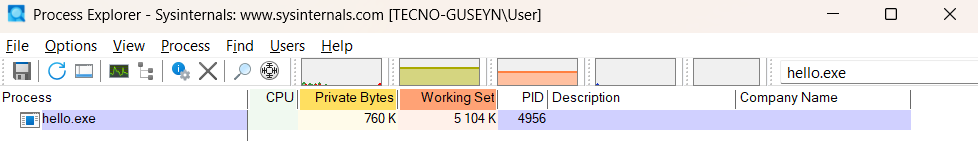

2. Показатели памяти:

   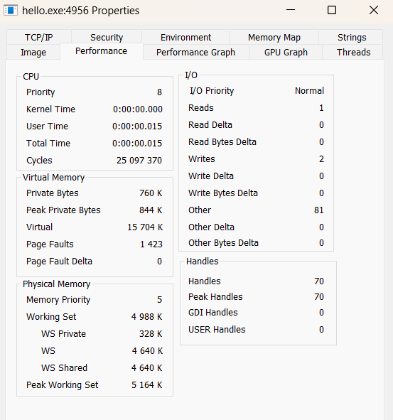

3. Открытые дескрипторы:

   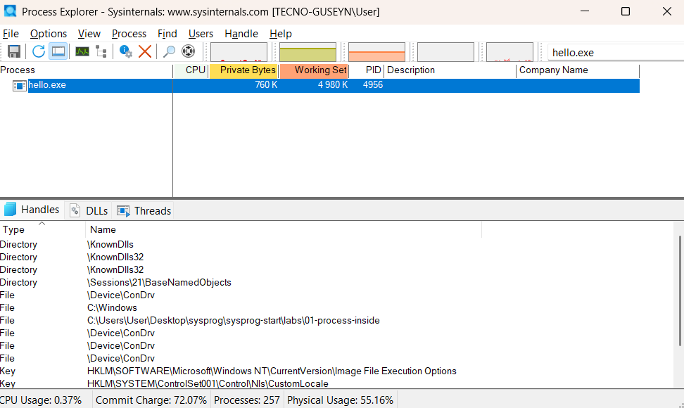

4. Загруженные библиотеки:

   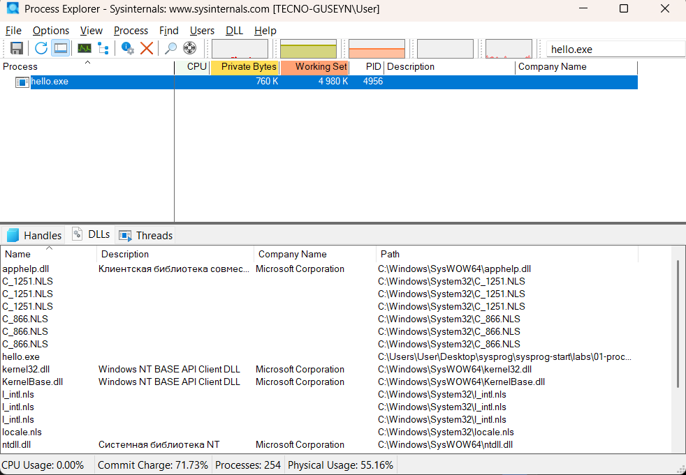

5. Подтверждение принудительного завершения:

   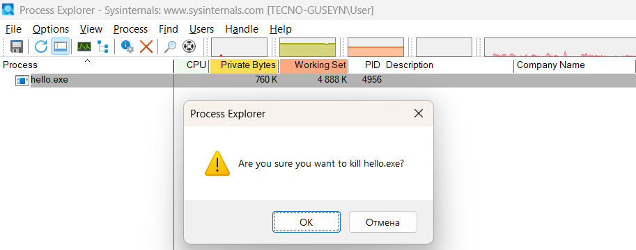

6. Отсутствие процесса после завершения:

   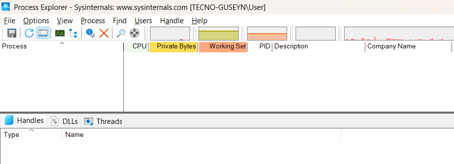

7. Терминал после принудительного завершения:

   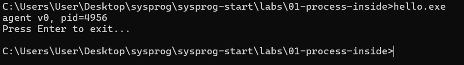

8. Обычное завершение через Enter:

   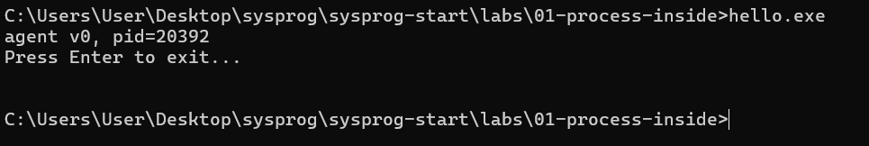

## Программа на Python

Имя процесса в мониторе: **python.exe**, PID **3500**, память **Private Bytes — 5 404 КБ, Working Set — 10 092 КБ**.

По показателю Private Bytes памяти больше, чем у программы на C, примерно в **7,1 раза** (5 404 / 760). Это связано в том числе с расходами памяти на интерпретатор Python.

Общая библиотека у программ на C и Python: **kernel32.dll**.

Код завершения при обычном выходе: **0**.

### Скриншоты: программа на Python

1. Процесс и PID:

   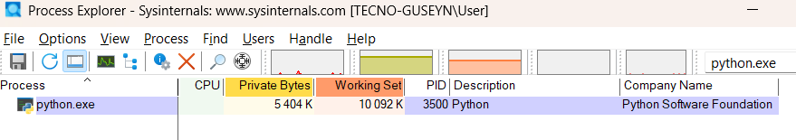

2. Показатели памяти:

   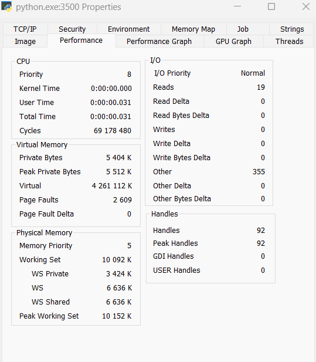

3. Открытые дескрипторы:

   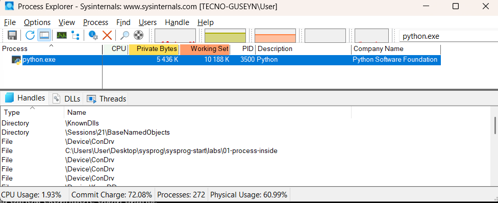

4. Загруженные библиотеки:

   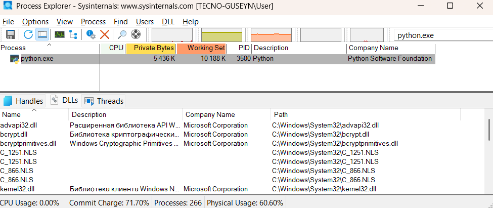

5. Обычное завершение через Enter:

   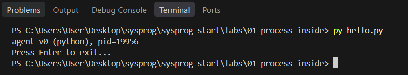

## Помощник ИИ (Р1)

**Запрос:** «Объясни программу hello.c по строкам».

ИИ объяснил подключение заголовочных файлов, получение PID с помощью `GetCurrentProcessId()`, вывод через `printf()` и ожидание ввода через `getchar()`. **Уточнение к объяснению:** `getchar()` считывает символ из стандартного ввода, а не является специальной командой ожидания именно клавиши Enter; при обычном вводе в консоли программа получает символ после подтверждения строки.

**Не получилось:** изначально команды `gcc` и `cl` не находились в PowerShell; компиляцию удалось выполнить через Visual Studio Developer Command Prompt. Также потребовалось исправить создание папки для скриншотов. Код завершения после Kill Process не был измерен.

**ИИ:** использовал для объяснения программы, настройки инструментов, изучения Process Explorer и оформления отчёта.
