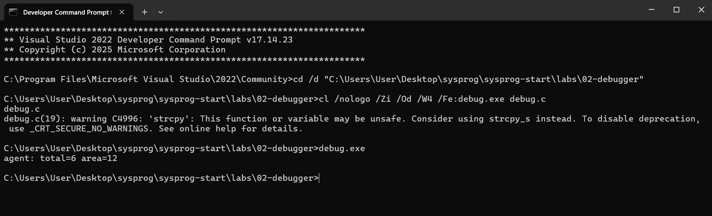
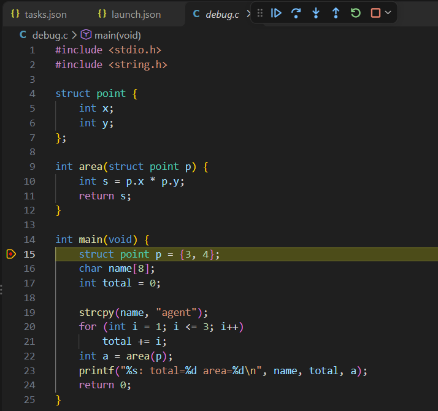
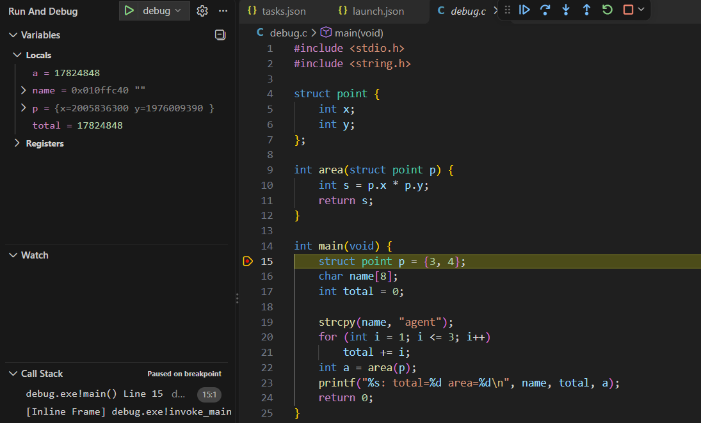
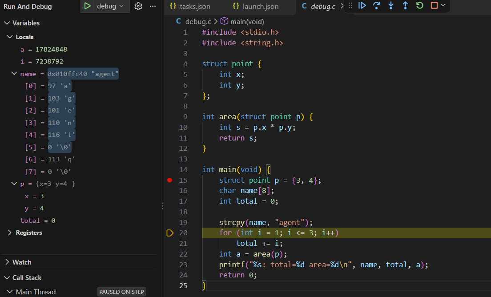
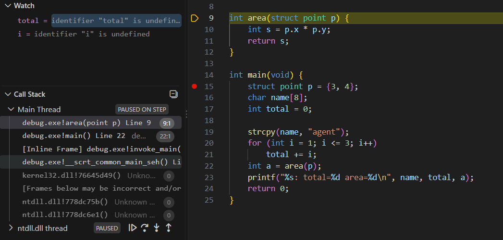
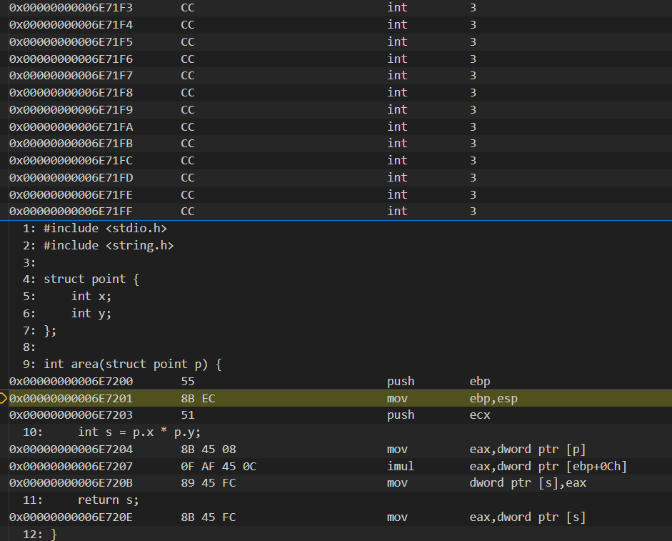
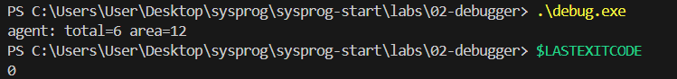

# ЛР 2. Программа в отладчике

Система: **Windows 11 · отладчик: Microsoft Visual Studio Debugger (cppvsdbg), VS Code**.

## Остановка и переменные

Программа без отладчика напечатала: `agent: total=6 area=12`.

Точка останова установлена на строке **15** (`struct point p = {3, 4};`).

До выполнения строки 15 отладчик показывал:
- `p.x = 2005836300`
- `p.y = 1976009390`
- `total = 17824848`

Эти значения не определены программой, поскольку соответствующие переменные ещё не были инициализированы.

После выполнения строки 15: **p.x = 3, p.y = 4**.

Строку 16 отладчик пропустил, потому что объявление массива `char name[8];` не содержит отдельной выполняемой операции, требующей остановки на исходной строке.

После выполнения `strcpy(name, "agent")` массив содержит символы строки `agent`.

`name[0] = 97` (код буквы `a`), завершающий ноль находится в ячейке **`name[5] = 0`**.

## Цикл и функция

На кадре цикла: **i = 3, total = 3; после следующего шага total = 6**.

В стеке внутри `area` находятся **две пользовательские функции: `area()` и `main()`**, сверху функция **`area()`**.

Команда умножения в машинном коде: **`imul eax, dword ptr [ebp+0Ch]`**.

Перед `printf`: **a = 12, total = 6**.

Итоговый вывод программы: `agent: total=6 area=12`.

Код завершения программы: **0**.

## Скриншоты

1. Сборка и запуск программы:

   

2. Точка останова на строке 15:

   

3. Остановка и значения переменных:

   

4. Содержимое массива `name`:

   

5. Наблюдение за циклом через Watch:

   

6. Стек вызовов функций:

   

7. Машинный код и инструкция `imul`:

   

8. Результат работы программы и код завершения:

   

## Помощник ИИ (Р1)

Запрос: «Почему до выполнения строки 15 в p.x лежит случайное число?»

Ответ ИИ: до выполнения инициализации `struct point p = {3, 4};` поля структуры ещё не получили заданные значения. Отладчик показывает содержимое соответствующей области памяти, которое нельзя считать корректными значениями переменных.

Ответ совпадает с объяснением шага 4: значения до инициализации неопределённы и могут меняться при повторном запуске программы.

**Не получилось:** возникли сложности с первоначальной настройкой сборки через MSVC и запуском отладчика. После исправления конфигурации программа успешно собрана и исследована.

**ИИ:** использовал для настройки `tasks.json` и `launch.json`, объяснения работы отладчика и помощи с оформлением отчёта.