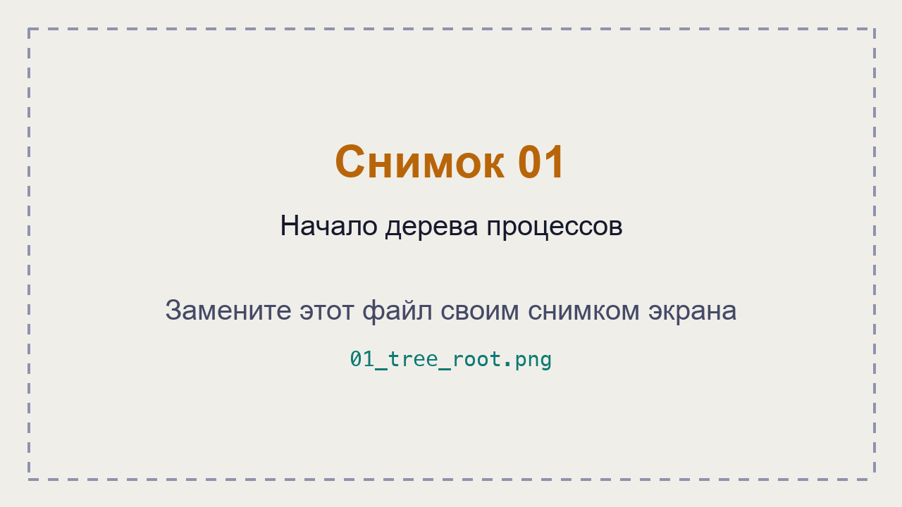
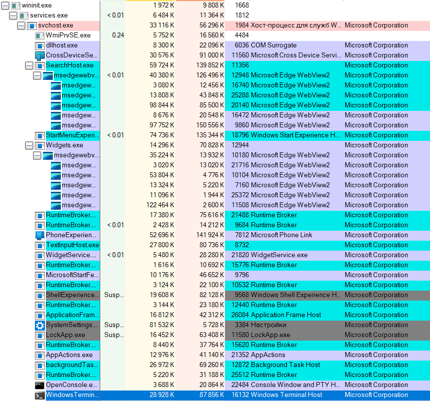
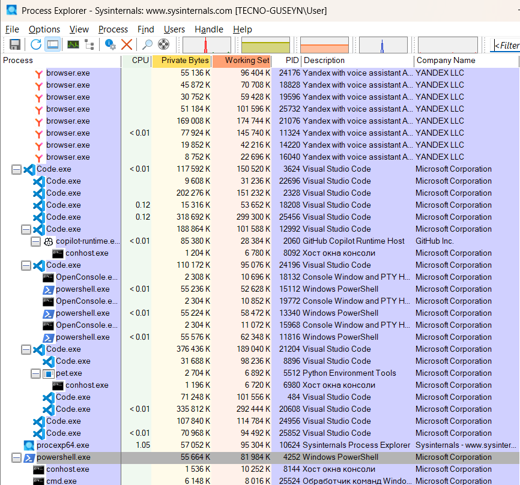
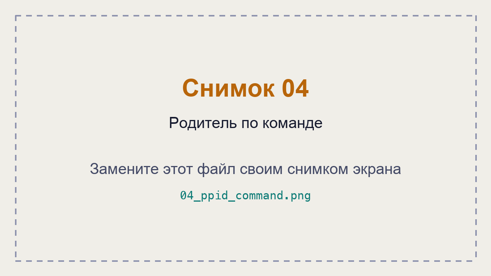
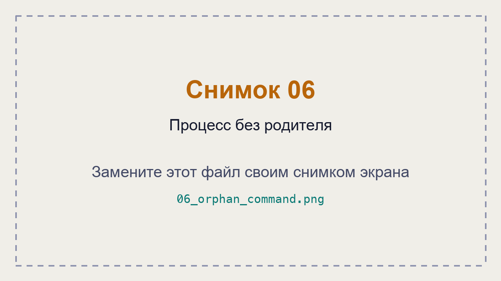
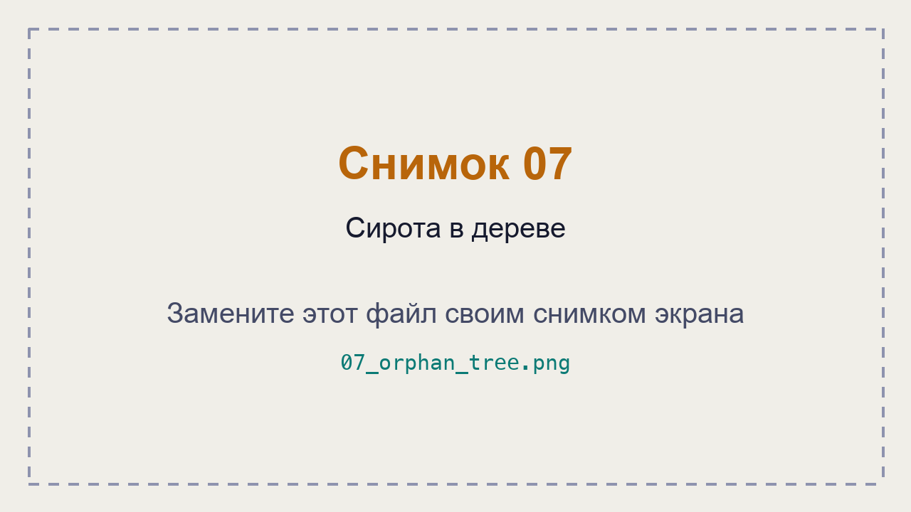

# ЛР 4. Дерево процессов

Система: **Windows 11**

## Дерево

**Процесс в начале дерева и его номер:** `System Idle Process` — PID 0; `System` — PID 4.

**Цепочка родителей терминала:** `System (4) → wininit.exe (1668) → services.exe (1812) → svchost.exe (1984) → WindowsTerminal.exe (16132)`.

**Дочерний процесс:** `cmd.exe` — PID **25524**, родитель `powershell.exe` — PID **4252**.

**Команда, которой проверен родитель:**

```powershell
Get-CimInstance Win32_Process -Filter "ProcessId = 25524" |
    Select-Object Name, ProcessId, ParentProcessId
```

**Процессов у браузера и имя процесса вкладок:** на момент исследования обнаружено 20 процессов Яндекс Браузера — `browser.exe`. Вкладки и другие компоненты браузера выполняются в отдельных процессах с тем же именем.

## Сирота

**Номер сироты:** `PING.EXE` — PID **12960**.

**Номер родителя до и после завершения настоящего родителя:** первоначальный PPID — **13940**. После завершения родителя поле `ParentProcessId` сохранило значение 13940, но процесс с этим PID больше не существовал.

**Где сирота стоит в дереве:** `PING.EXE` отображался отдельно, на верхнем уровне дерева Process Explorer, без родительской ветки.

**Не получилось:** первоначально возникли сложности с поиском родительских процессов при включённом фильтре Process Explorer. После отключения фильтра удалось исследовать дерево и выполнить все этапы.

## Снимки экрана

### 1. Начало дерева процессов



### 2. Терминал и его родители



### 3. Дочерний процесс терминала



### 4. Родитель по команде



### 5. Процессы браузера


### 6. Процесс без родителя



### 7. Сирота в дереве

