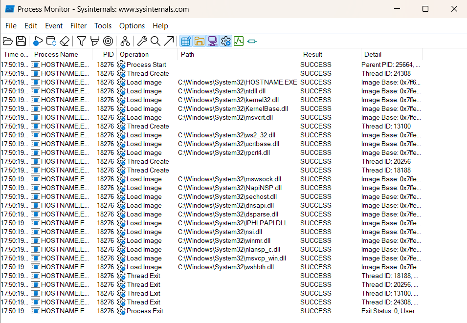
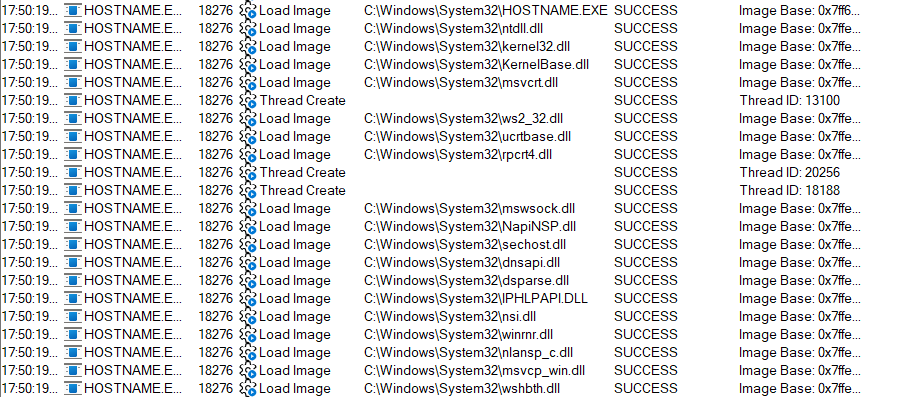
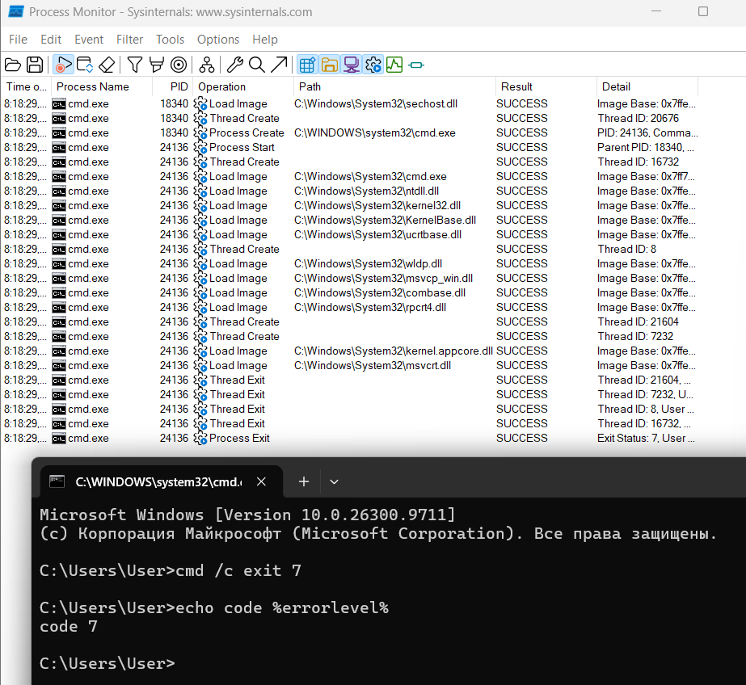
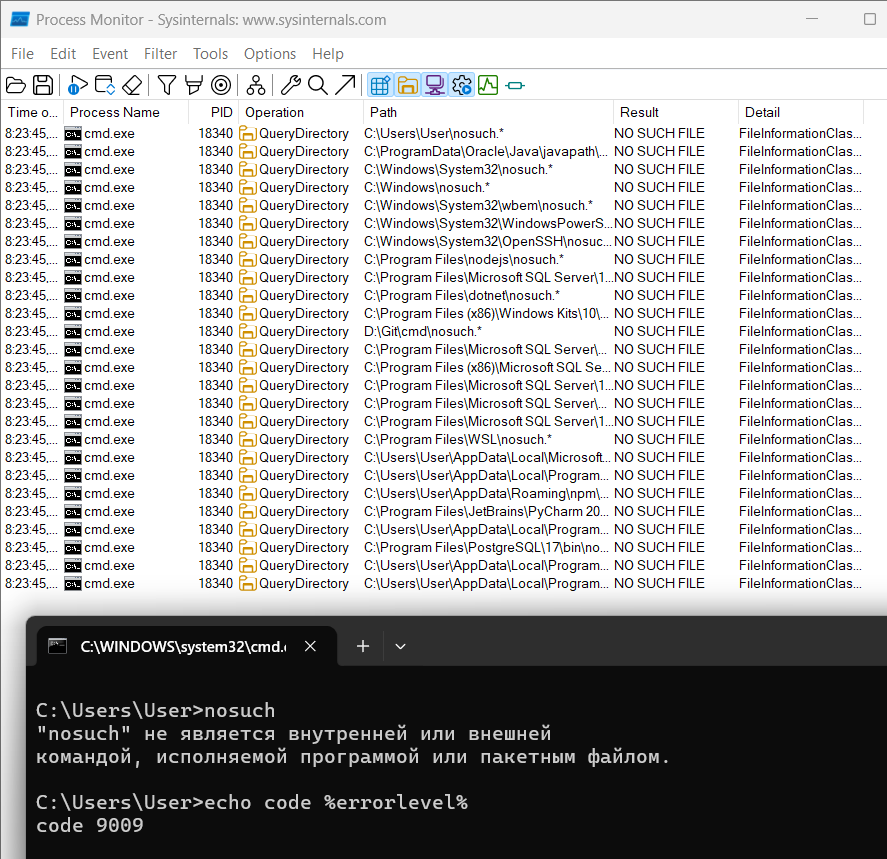
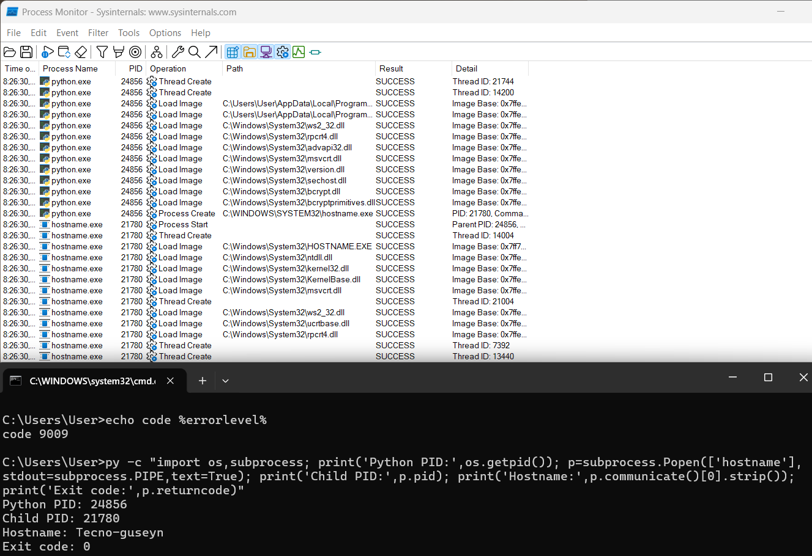

# ЛР 5. Рождение процесса

Система: **Windows 11**

Программа записи: **Process Monitor (Microsoft Sysinternals)**

## Рождение

**Родитель (имя и номер):** `cmd.exe`, PID 25664.

**Номер нового процесса:** `HOSTNAME.EXE`, PID 18276.

**Событие или вызов, которым создан процесс:** `Process Create` — создание процесса родительской программой, затем `Process Start` — запуск нового процесса.

**Библиотек загружено и первая из них:** на снимке зафиксирована загрузка 18 DLL. Первая библиотека — `ntdll.dll` (после загрузки самого `HOSTNAME.EXE`). Также загружены `kernel32.dll`, `KernelBase.dll`, `msvcrt.dll` и другие.

## Завершение

**Код завершения у ребёнка и у родителя:** дочерний `cmd.exe` завершился с кодом **7**. Родительский `cmd.exe` получил тот же код — **7**, что подтверждено командой `echo code %errorlevel%`.

**Программа nosuch:** проверено **22 каталога** по данным Process Monitor. Результат поиска — `NO SUCH FILE`. Командная строка сообщила, что программа не найдена. Код ошибки — **9009**.

## Запуск из Python

**Номер Python и номер ребёнка:** `python.exe` — PID **24856**, дочерний `hostname.exe` — PID **21780**.

**Чем запуск из Python отличается от запуска из оболочки:** в Python процесс создаётся через `subprocess.Popen()`, а в командной строке — при выполнении команды оболочкой. В обоих случаях Windows создаёт отдельный процесс, но родителем выступает программа, которая его запустила. Python также позволяет получать вывод и код завершения дочернего процесса.

Результат выполнения Python:
- `Python PID: 24856`
- `Child PID: 21780`
- `Exit code: 0`

**Не получилось:** первоначально был зафиксирован обычный код завершения 0 вместо требуемого 7, а также использован `cmd.exe` вместо `hostname.exe` для запуска из Python. После повторного выполнения все необходимые результаты получены.

## Снимки экрана

### 1. Рождение процесса

Шаг 1. Видно: запись запуска `hostname`, создание процесса родителем и номер нового процесса.

### 2. Библиотеки нового процесса

Шаг 2. Видно: библиотеки, которые загрузил `hostname`, включая `ntdll.dll`, `kernel32.dll` и другие.

### 3. Код завершения 7

Шаг 3. Видно: завершение дочернего `cmd.exe` с кодом 7 и получение того же кода родителем.

### 4. Программы нет

Шаг 4. Видно: поиск `nosuch` по каталогам, результат `NO SUCH FILE` и код ошибки 9009.

### 5. Запуск из Python

Шаг 5. Видно: Python создаёт дочерний процесс `hostname.exe`, указаны PID родителя и ребёнка.

