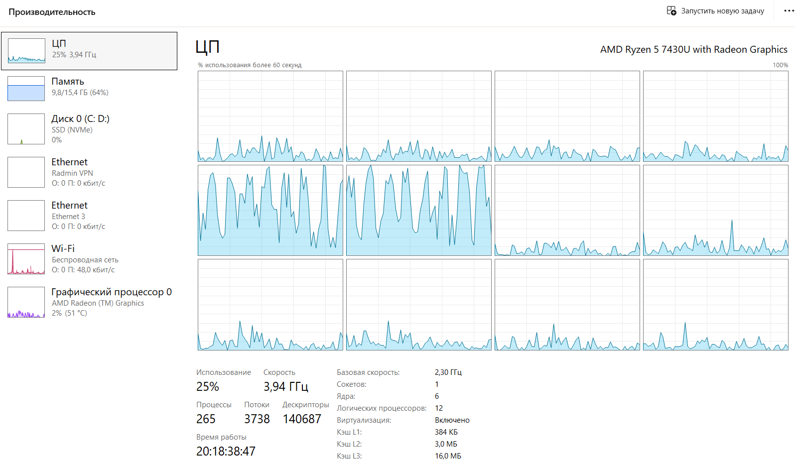
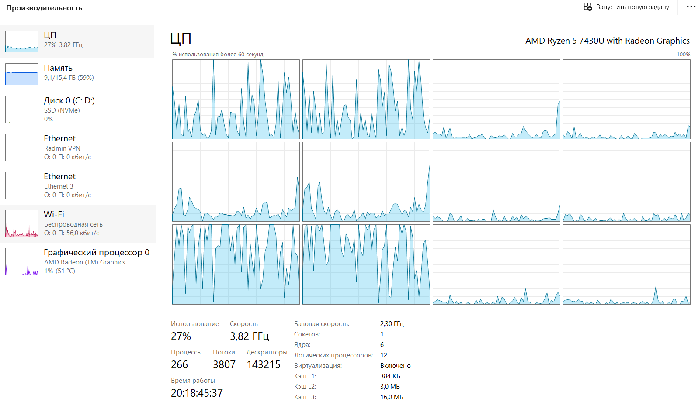
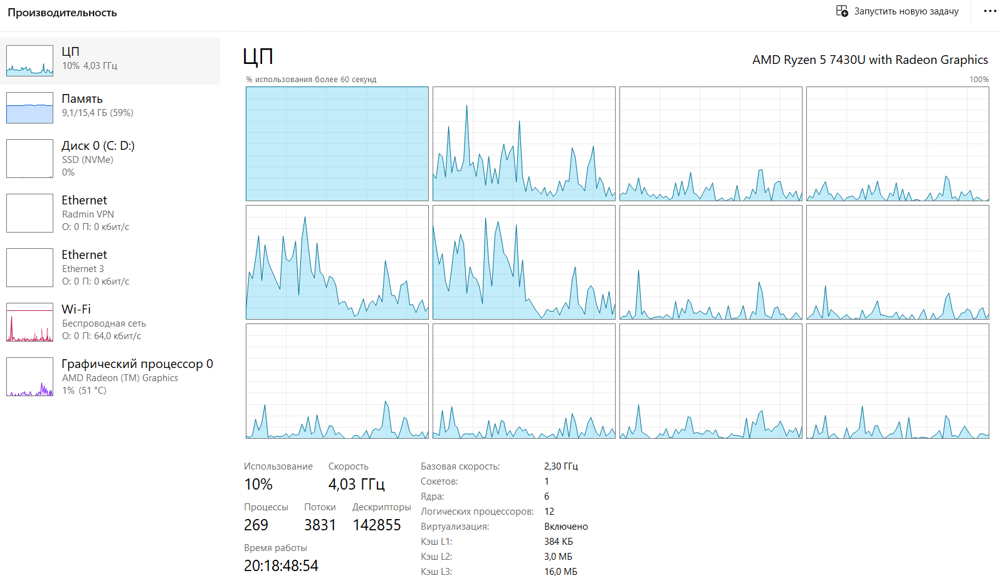
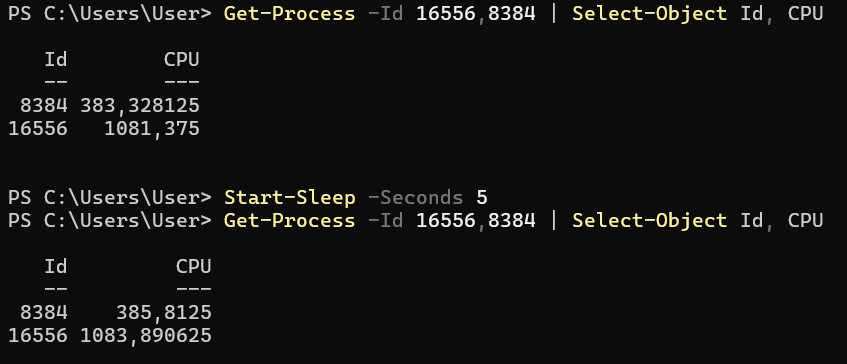

# ЛР 6. Кто загружает процессор

Система: **Windows 11**

Ядер (логических процессоров): **12** (6 физических ядер).

## Одна нагрузка

**Процент процесса в мониторе:** `python.exe` (PID 16556) — **8% ЦП**.

**Общая загрузка:** **25%**.

**На каких ядрах видна нагрузка:** наиболее заметная активность наблюдалась на логических процессорах ЦП 4 и ЦП 5 (нумерация с нуля). Нагрузка распределялась системой между логическими процессорами.

## Две нагрузки

**Проценты обеих нагрузок и общая загрузка:**
- `python.exe` (PID 16556) — **8%**.
- `python.exe` (PID 8384) — **8%**.
- Суммарная загрузка двух процессов — **16%**.
- Общая загрузка процессора — **27%**.

**На одном ядре:** после ограничения обоих Python-процессов логическим процессором ЦП 0 каждый использовал примерно **4%** общей вычислительной мощности. Вместе процессы занимали около **8%**, а общая загрузка системы составляла **10%**. График ЦП 0 показывал загрузку 100%.

## Процессорное время

**Первый замер, второй замер, пауза:** 5 секунд.

| PID | Первый замер (сек.) | Второй замер (сек.) | Разница (сек.) |
|---|---:|---:|---:|
| 8384 | 383,328125 | 385,8125 | 2,484375 |
| 16556 | 1081,375 | 1083,890625 | 2,515625 |
| **Итого** | | | **5,000000** |

**Загрузка по замерам:**
- PID 8384 — **49,69% одного логического процессора**.
- PID 16556 — **50,31% одного логического процессора**.
- Суммарная нагрузка — **100% одного логического процессора**, или приблизительно **8,33% общей загрузки при 12 логических процессорах**.

**Почему процент в мониторе не говорит о скорости работы:** процент ЦП показывает, насколько процесс использует вычислительные ресурсы за определённый промежуток времени, но не отражает скорость выполнения конкретной задачи. Скорость также зависит от производительности процессора, его частоты, количества доступных ядер и особенностей программы.

**Не получилось:** существенных проблем не возникло. Для сравнения нагрузки пришлось переключаться между вкладками «Сведения» и «Производительность» диспетчера задач.

## Снимки экрана

### 1. Одна нагрузка

Шаг 1. Видно: процесс Python с загрузкой около 8% и общая загрузка ЦП 25%.

### 2. Две нагрузки

Шаг 3. Видно: работа двух Python-процессов, каждый использует около 8% ЦП, общая загрузка — 27%.

### 3. Нагрузки на одном ядре

Шаг 4. Видно: два Python-процесса ограничены логическим процессором ЦП 0 и используют приблизительно по 4% ЦП каждый.

### 4. Процессорное время

Шаг 5. Видно: два замера процессорного времени с паузой 5 секунд и увеличение CPU Time обоих процессов.

