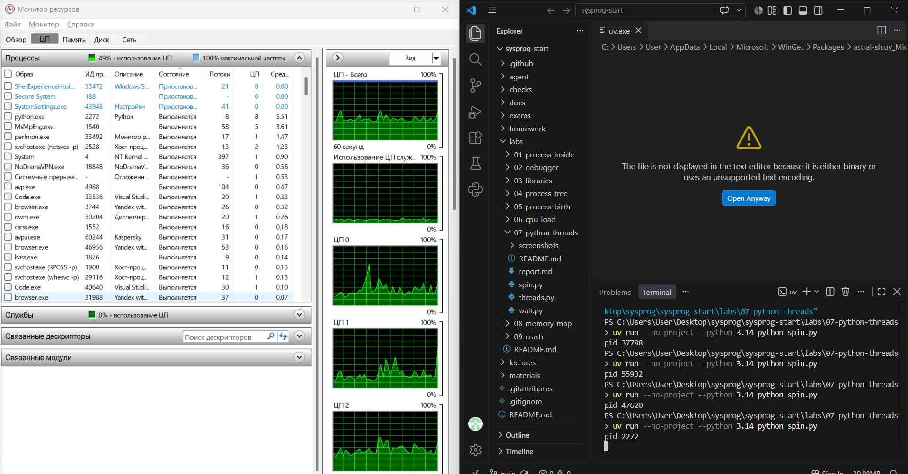
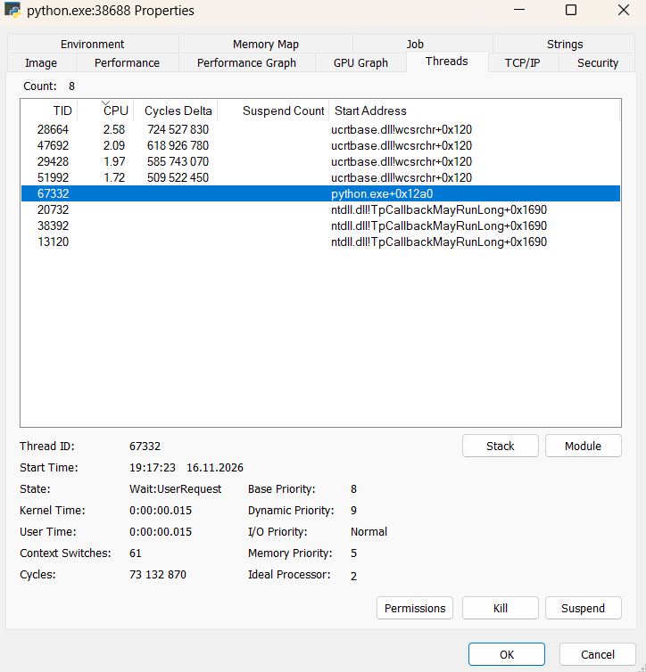
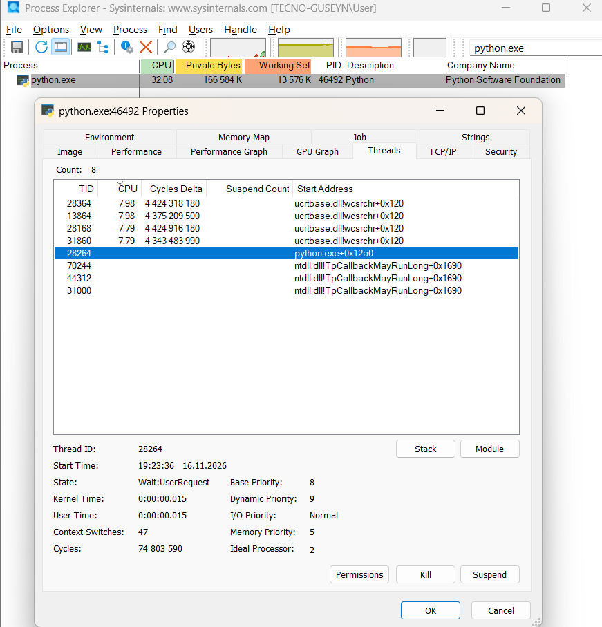

# ЛР 7. Потоки Python и GIL

Система: **Windows 11**  
Ядер (логических процессоров): **6 физических ядер, 12 логических процессоров**  
Версии Python (обычный и без GIL): **CPython 3.14.10 (обычная сборка, GIL включён); CPython 3.14.10t (free-threaded, GIL отключён по умолчанию)**

## Python с GIL

**Процент процесса и число потоков:** `python.exe` потреблял около **8%** общей загрузки ЦП. В Process Explorer и Мониторе ресурсов отображалось **8 потоков** процесса, в том числе четыре вычислительных потока.

**Сколько потоков выполняется одновременно:** несмотря на наличие четырёх вычислительных потоков, в обычной сборке CPython с GIL в каждый момент времени Python-код внутри процесса исполняет не более **одного** потока. Потоки чередуются; показания процента использования каждого потока — усреднение за интервал мониторинга, а не доказательство их одновременного исполнения.

## Python без GIL

**Процент процесса и проценты потоков:** `python.exe` использовал около **32–33%** общей мощности ЦП. Четыре вычислительных потока одновременно выполнялись на разных логических процессорах, каждый потреблял примерно **7,8–8,3%** общей загрузки ЦП. Process Explorer показывал **8 потоков** в процессе (включая вспомогательные).

## Время работы

| Режим | 1 поток | 2 потока | 4 потока |
|---|---:|---:|---:|
| Python 3.14.10, GIL включён | 5,20 с | 4,72 с | 4,59 с |
| Python 3.14.10t, GIL выключен | 5,48 с | 2,98 с | 1,80 с |
| Python 3.14.10t, `PYTHON_GIL=1` | 5,07 с | 5,09 с | 5,95 с |

**С GIL, 1 / 2 / 4 потока:** 5,20 / 4,72 / 4,59 с.  
**Без GIL, 1 / 2 / 4 потока:** 5,48 / 2,98 / 1,80 с.  
**Без GIL с `PYTHON_GIL=1`:** 5,07 / 5,09 / 5,95 с (GIL принудительно включён).

**Ожидание, 1 и 4 потока (`wait.py`):**

| Режим | 1 поток | 4 потока |
|---|---:|---:|
| С GIL | 2,00 с | 2,00 с |
| Без GIL | 2,00 с | 2,00 с |

**Почему ожидающие потоки ускоряются и с GIL:** операции ожидания, такие как `time.sleep()`, освобождают GIL. Поэтому несколько потоков могут ожидать одновременно, и четыре ожидания по две секунды занимают приблизительно две секунды общего времени, а не восемь. Для задач с ожиданием ввода-вывода потоки полезны даже с GIL.

**Вывод:** в эксперименте с вычислениями четыре потока без GIL завершили работу примерно в **2,55 раза быстрее** четырёх потоков с GIL (**1,80 с** против **4,59 с**). При `PYTHON_GIL=1` ускорение отсутствовало: четыре потока работали **5,95 с**. Разница в небольших временах внутри режима с GIL может быть обусловлена измерительными колебаниями, а не реальным распараллеливанием Python-кода. Во время ожидания (`wait.py`) оба режима завершились приблизительно за 2 секунды независимо от числа потоков.

**Не получилось:** существенных проблем в выполнении экспериментов не возникло. Для захвата списка потоков в Process Explorer пришлось несколько раз запускать короткий `spin.py`, так как он работал около 15 секунд. Испытания обеих сборок и замеры времени выполнены.

## Снимки экрана

Снимки сохранены в `screenshots/` поверх заглушек с теми же именами.

### 1. Четыре потока с GIL

Шаг 1. Виден процесс Python с включённым GIL: около 8% использования ЦП и 8 потоков процесса.

### 2. Потоки процесса

Шаг 2. В Process Explorer видны 8 потоков: четыре вычислительных потока с распределённым во времени использованием ЦП и вспомогательные потоки, в том числе ожидающие.

### 3. Четыре потока без GIL

Шаг 3. В Process Explorer видны около 32% загрузки ЦП процессом Python и четыре вычислительных потока примерно по 8% каждый.

### 4. Время работы

Шаг 4. В терминале видны замеры `threads.py` с GIL и без GIL, а также `wait.py` в обоих режимах. Дополнительный запуск с `PYTHON_GIL=1` отражён в таблице отчёта.

