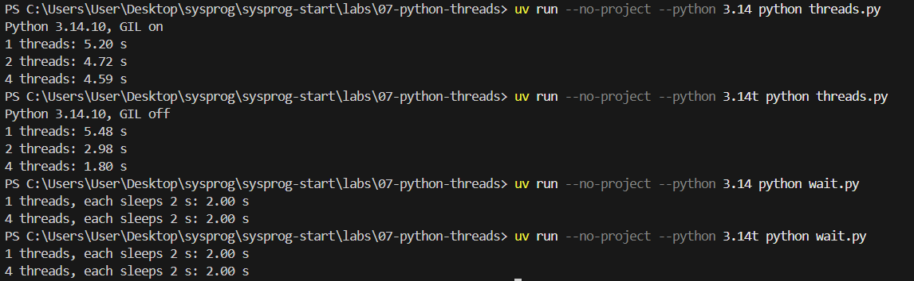

# ЛР 7. Потоки Python и GIL

Система: **Windows 11**.

Ядер (логических процессоров): **6 физических ядер, 12 логических процессоров**.

Версии Python (обычный и без GIL): **CPython 3.14.10** (`GIL: True`) и **CPython 3.14.10 free-threaded** (`GIL: False`, Python 3.14t).

## Python с GIL

**Процент процесса и число потоков:** `python.exe` потреблял около **8% общей загрузки ЦП**. Process Explorer показывал **8 потоков** в процессе, включая **4 вычислительных**.

**Сколько потоков выполняется одновременно:** при включённом GIL Python-код из четырёх вычислительных потоков выполнялся поочерёдно: в один момент на Python-уровне исполняется один поток. Потоки переключались между собой; это не означает, что в процессе существует всего один поток.

## Python без GIL

**Процент процесса и проценты потоков:** при запуске через Python 3.14t без GIL процесс потреблял приблизительно **32–33% общей загрузки ЦП**. Четыре вычислительных потока потребляли около **7,8–8,3% ЦП каждый**, что демонстрирует параллельное исполнение на нескольких логических процессорах.

## Время работы

| Потоки | С GIL | Без GIL | Python 3.14t с `PYTHON_GIL=1` |
|---|---:|---:|---:|
| 1 поток | 5,20 с | 5,48 с | 5,07 с |
| 2 потока | 4,72 с | 2,98 с | 5,09 с |
| 4 потока | 4,59 с | 1,80 с | 5,95 с |

**С GIL, 1 / 2 / 4 потока:** 5,20 / 4,72 / 4,59 с.

**Без GIL, 1 / 2 / 4 потока:** 5,48 / 2,98 / 1,80 с.

**Без GIL с `PYTHON_GIL=1`:** 5,07 / 5,09 / 5,95 с соответственно. При принудительном включении GIL параллельное ускорение исчезло.

**Ожидание, 1 и 4 потока:** с GIL — 2,00 и 2,00 с; без GIL — 2,00 и 2,00 с.

**Почему ожидающие потоки ускоряются и с GIL:** во время `time.sleep()` поток освобождает GIL и не занимает процессор вычислениями. Поэтому четыре потока могут ожидать одновременно: общее время приблизительно 2 секунды, а не 8 секунд. Это позволяет выполнять операции ожидания конкурентно даже с GIL.

**Вывод:** в тесте `threads.py` четыре вычислительных потока без GIL завершили работу приблизительно в **2,55 раза быстрее**, чем четыре потока обычного CPython (1,80 против 4,59 с). При `PYTHON_GIL=1` преимущество исчезло. Для ожидающих потоков существенной разницы между двумя сборками не было.

**Не получилось:** существенных проблем при измерениях не возникло. Для снимков процесса приходилось несколько раз запускать `spin.py`, поскольку он работает 15 секунд.

## Снимки экрана

### 1. Четыре потока с GIL

Шаг 1. Видно: процесс Python в Мониторе ресурсов, около 8% загрузки ЦП и 8 потоков процесса.

### 2. Потоки процесса

Шаг 2. Видно: вкладка Threads в Process Explorer, 8 потоков, из них 4 активных вычислительных потока.

### 3. Четыре потока без GIL

Шаг 3. Видно: процесс Python без GIL (32–33% ЦП) и четыре параллельно активных вычислительных потока.

### 4. Время работы

Шаг 4. Видно: измерения `threads.py` с GIL и без GIL, а также измерения `wait.py`.

