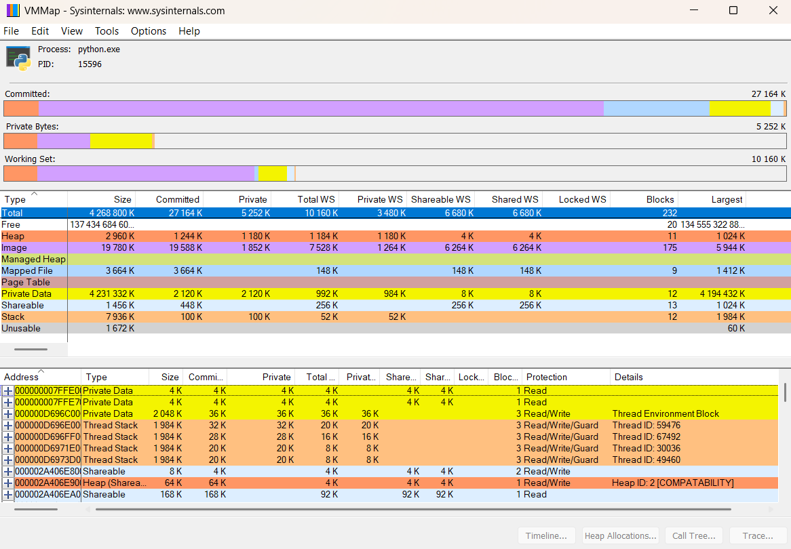
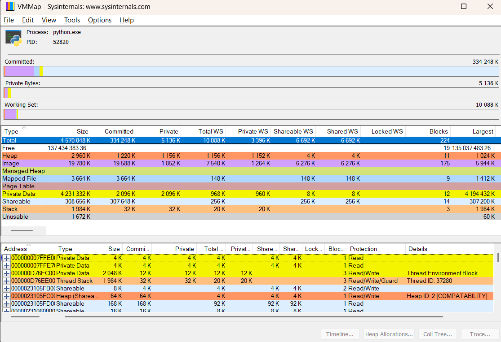
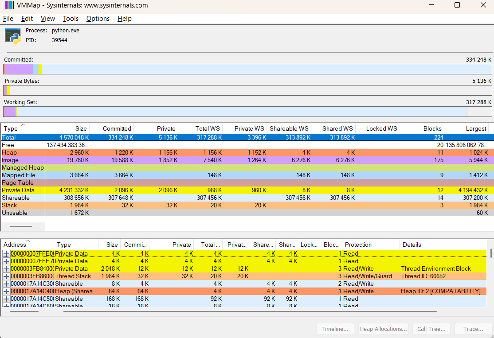
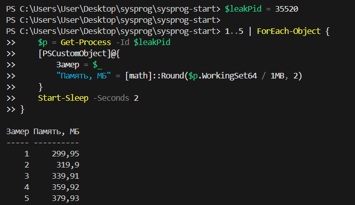

# ЛР 8. Карта памяти

Система: **Windows 11, 64-разрядная**

Чем мерил (виртуальная и занятая): **VMMap (Microsoft Sysinternals)** — показатели Committed, Private Bytes и Working Set. Для дополнительных замеров утечки использовал PowerShell (`Get-Process`, `WorkingSet64`).

## Этапы mem.py

| Этап | Committed | Working Set |
|---|---:|---:|
| Старт | 27 164 КБ | 10 160 КБ |
| Получил 300 МБ | 334 248 КБ | 10 088 КБ |
| Записал в каждую страницу | 334 248 КБ | 317 288 КБ |
| Освободил | 27 060 КБ | 10 108 КБ |

**Старт:** процесс Python использовал 27 164 КБ Committed и 10 160 КБ Working Set.

**Получил 300 МБ:** после создания `mmap` показатель Committed увеличился до 334 248 КБ, но Working Set практически не изменился.

**Записал в каждую страницу:** после записи в каждую страницу памяти Working Set вырос до 317 288 КБ. Committed остался на уровне 334 248 КБ.

**Освободил:** после вызова `data.close()` Committed уменьшился до 27 060 КБ, а Working Set — до 10 108 КБ. Показатели вернулись примерно к исходным значениям.

**Почему занятая память выросла только на третьем этапе:** выделение памяти через `mmap` не означает, что все страницы сразу находятся в оперативной памяти. При записи в каждую страницу происходят обращения к памяти, после которых страницы становятся физически присутствующими в рабочем наборе процесса. Поэтому Working Set значительно увеличился только после записи.

## Карта памяти

**Из каких частей состоит память процесса:** по данным VMMap в карте памяти Python присутствовали Heap, Image, Managed Heap, Mapped File, Page Table, Private Data, Shareable, Stack, а также свободные и непригодные для использования участки адресного пространства.

Heap используется для динамических выделений памяти, Image — для загруженных исполняемых файлов и библиотек, Stack — для стеков потоков. Mapped File и Shareable связаны с отображаемой и разделяемой памятью, Private Data — с частными участками памяти процесса.

В эксперименте выделенные 300 МБ отображались преимущественно в категории Shareable.

## Утечка

**Пять замеров leak.py:** измерения выполнены с интервалом 2 секунды.

| Замер | Working Set, МБ |
|---|---:|
| 1 | 299,95 |
| 2 | 319,90 |
| 3 | 339,91 |
| 4 | 359,92 |
| 5 | 379,93 |

**На сколько росла память за 2 секунды:** приблизительно на 20 МБ, или около 10 МБ в секунду.

**Вывод:** программа `leak.py` постепенно накапливала данные в памяти, из-за чего Working Set непрерывно увеличивался. Это демонстрирует ситуацию, похожую на утечку памяти, когда программа продолжает удерживать данные, которые могли бы быть освобождены.

**Общий вывод:** виртуальная и физически занятая память — разные показатели. Выделение памяти увеличивает Committed, а обращение к страницам увеличивает Working Set. После освобождения памяти показатели снижаются. При накоплении данных без освобождения потребление памяти процесса постепенно растёт.

Не получилось: **существенных проблем не возникло. Для получения снимков пришлось несколько раз запускать `mem.py`, поскольку каждый этап длится 20 секунд.**

## Снимки экрана

Снимки сохранены поверх заглушек в папке `screenshots/`.

### 1. Карта памяти

Шаг 2. Видно: карта памяти процесса `mem.py` на старте, значения Committed и Working Set.

### 2. Получено 300 МБ

Шаг 3. Видно: показатель Committed вырос примерно на 300 МБ, а Working Set практически не изменился.

### 3. Страницы заняты

Шаг 4. Видно: после записи в каждую страницу Working Set увеличился до 317 288 КБ.

### 4. Утечка

Шаг 6. Видно: пять последовательных замеров `WorkingSet64` процесса `leak.py` с интервалом 2 секунды.

