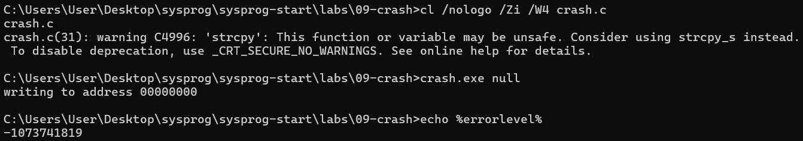
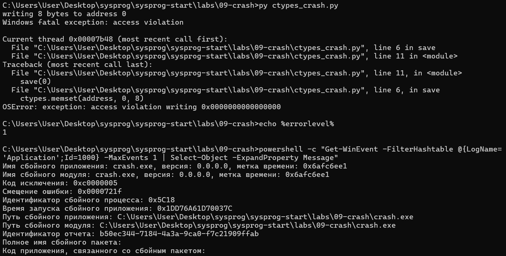
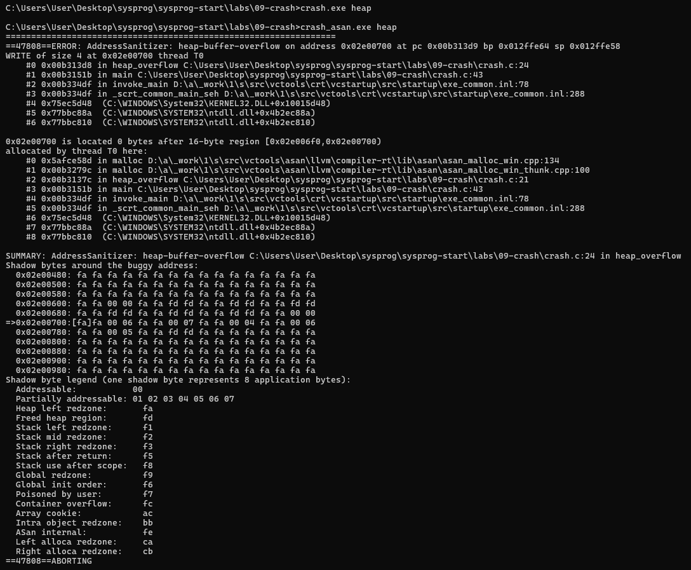
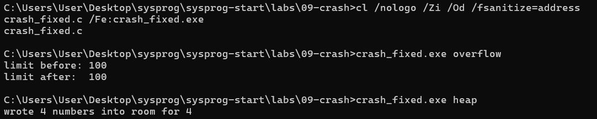

# ЛР 9. Разбор падения

Система: Windows 11, 64-разрядная.

Компилятор: Microsoft Visual C/C++ (MSVC) 19.44.35222, x86. Использован AddressSanitizer (`/fsanitize=address`).

## Падение

**crash null: что напечатано и код завершения:** программа вывела `writing to address 00000000` и аварийно завершилась с кодом `-1073741819` (`0xC0000005` — нарушение доступа к памяти).

**ctypes_crash.py: что напечатал Python:** программа вывела `writing 8 bytes to address 0`, затем `Windows fatal exception: access violation`. В traceback указано `ctypes_crash.py:6`, вызов `ctypes.memset(address, 0, 8)`. Python сообщил `OSError: exception: access violation writing 0x0000000000000000`. Код завершения — `1`.

**Где система записала падение:** журнал Windows `Application`, событие с ID `1000`. В записи указаны `crash.exe` и код исключения `0xC0000005`.

## Молчаливые ошибки

**crash overflow: limit до и после, код:** до записи `limit = 100`, после записи `limit = 7`. Причина — цикл с условием `i <= 4`, который выполнял пять записей в массив из четырёх элементов. Программа продолжила выполнение, хотя повредила соседние данные.

**crash heap без проверки:** программа завершилась без диагностического сообщения. Выход за границы динамически выделенного массива не был обнаружен обычным запуском.

**AddressSanitizer для heap: вид ошибки и строка:** `heap-buffer-overflow`, запись четырёх байт за пределами выделенного участка памяти. Ошибка обнаружена в `crash.c:24`, вызов из `main` — строка 43.

**AddressSanitizer для uaf: вид ошибки и две строки:** `heap-use-after-free`, чтение уже освобождённой памяти. Память освобождена в `crash.c:32`, повторное обращение произошло в `crash.c:33`.

## Исправление

**Что изменено и что напечатала исправленная программа:** создан файл `crash_fixed.c` на основе `crash.c`. В двух циклах условие `i <= 4` заменено на `i < 4`, чтобы запись выполнялась только в пределах массива.

Исправленная программа собрана с AddressSanitizer.

Результат режима `overflow`:

```text
limit before: 100
limit after:  100
```

Результат режима `heap`:

```text
wrote 4 numbers into room for 4
```

В этих двух режимах AddressSanitizer ошибок не обнаружил. Исходный `crash.c` сохранён для демонстрации ошибок. Режимы `null` и `uaf` в исправленной копии отдельно не исправлялись.

**Не получилось:** существенных проблем не возникло. Обычный запуск не обнаружил выход за границы динамического массива, однако AddressSanitizer успешно выявил ошибку с указанием строки исходного кода.

**Вывод:** ошибки обращения к памяти могут приводить как к аварийному завершению программы, так и к незаметному повреждению данных. AddressSanitizer помогает находить ошибки, которые не выявляются при обычном запуске, и показывает место их возникновения.

## Снимки экрана

### 1. Падение

Шаг 1. Видно: запуск `crash.exe null` и код завершения `-1073741819`.



### 2. Падение Python

Шаг 2. Видно: вывод `ctypes_crash.py`, нарушение доступа к памяти и запись журнала Windows о падении `crash.exe`.



### 3. Отчёт AddressSanitizer

Шаг 4. Видно: `heap-buffer-overflow`, обнаруженный AddressSanitizer, и строка `crash.c:24`.



### 4. Исправление

Шаг 6. Видно: компиляция исправленной программы и успешные результаты режимов `overflow` и `heap`. Изменения условий циклов подтверждены сравнением файлов.

