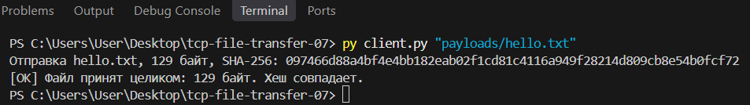
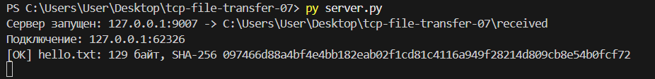
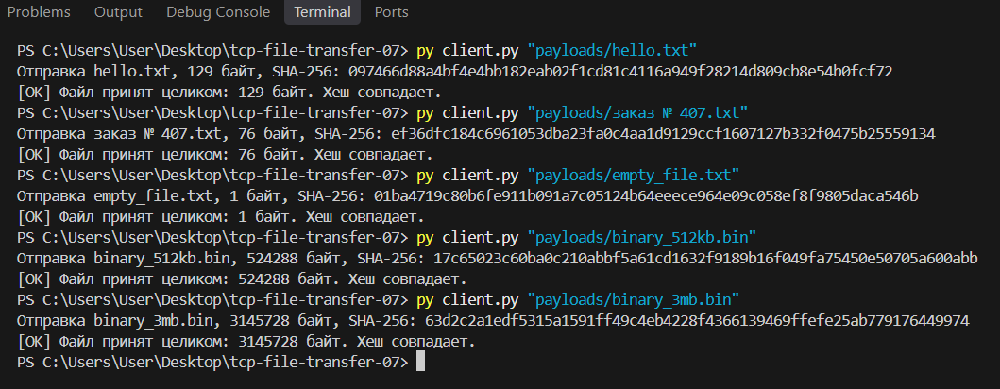
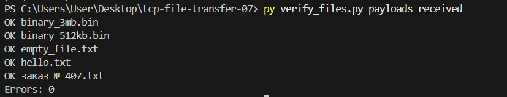
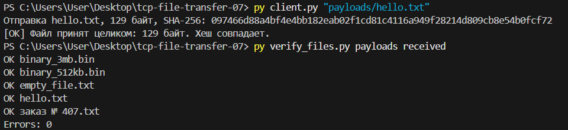
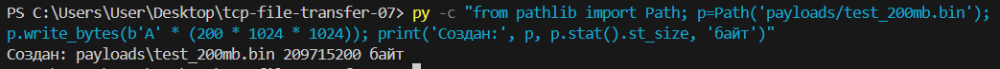
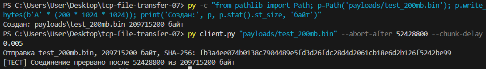
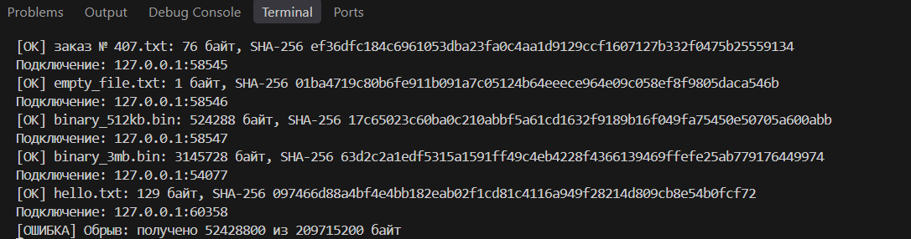
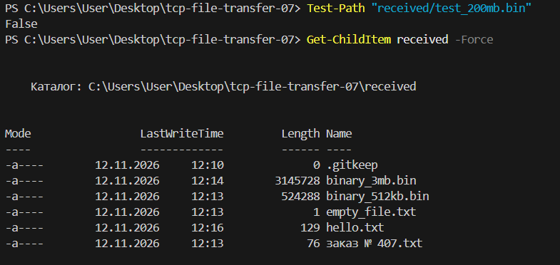
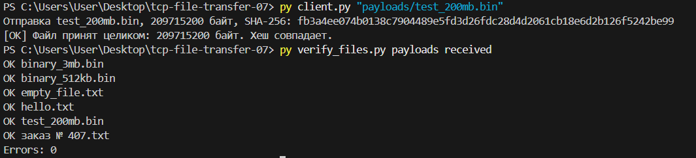

# Прикладной кейс: передача файлов по TCP на Python

**Дисциплина:** Системное программирование  
**Формат:** практическая работа  
**Цель:** передать файлы между TCP-клиентом и сервером, проверить целостность по SHA-256 и обработку разрыва соединения.

## Что реализовано и проверено

По представленному отчёту созданы TCP-сервер и TCP-клиент на Python. Проверялись текстовые, двоичные и большие файлы, повторная отправка и обрыв соединения.

| Проверка | Результат |
|---|---|
| Запуск сервера и подключение клиента | Успешно |
| Передача `hello.txt` | 129 из 129 байт; SHA-256 совпадает |
| Передача пяти файлов | Успешно; хеши совпали |
| Повторная отправка файла | Успешно |
| Обрыв соединения после 50 МиБ | Обнаружен; повреждённый файл не сохранён |
| Передача файла 200 МиБ | Успешно |
| Финальная проверка шести файлов | `Errors: 0` |

## Скриншоты проверки

### Первая передача

### Серия файлов и проверка хешей

### Большой файл и имитация обрыва

## Вывод

Передача файлов по TCP и контроль целостности SHA-256 проверены. При разрыве соединения обнаружена ошибка и неполный файл не сохранён. Файл 200 МиБ передан успешно, итоговая проверка шести файлов завершилась с `Errors: 0`.

## Что осталось

- Проверить передачу между двумя компьютерами в локальной сети.

> **Примечание:** в предоставленном Word-документе содержались отчёт и скриншоты, но не исходники `server.py`, `client.py`, `verify_files.py`. Их следует добавить отдельно, если преподаватель требует сдавать исполняемый код.
